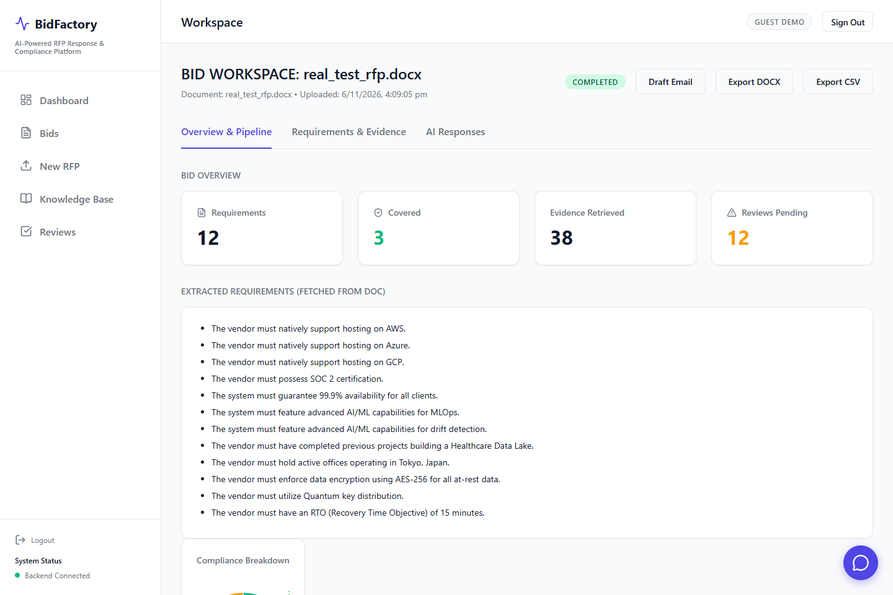
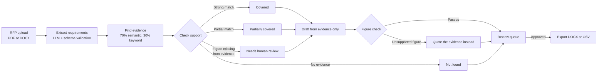
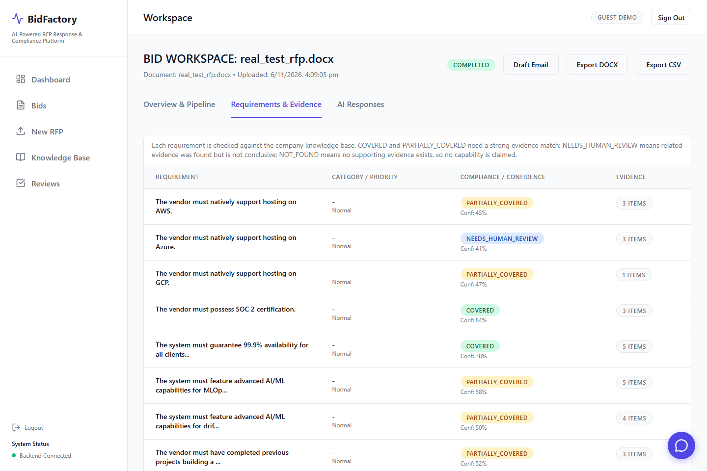
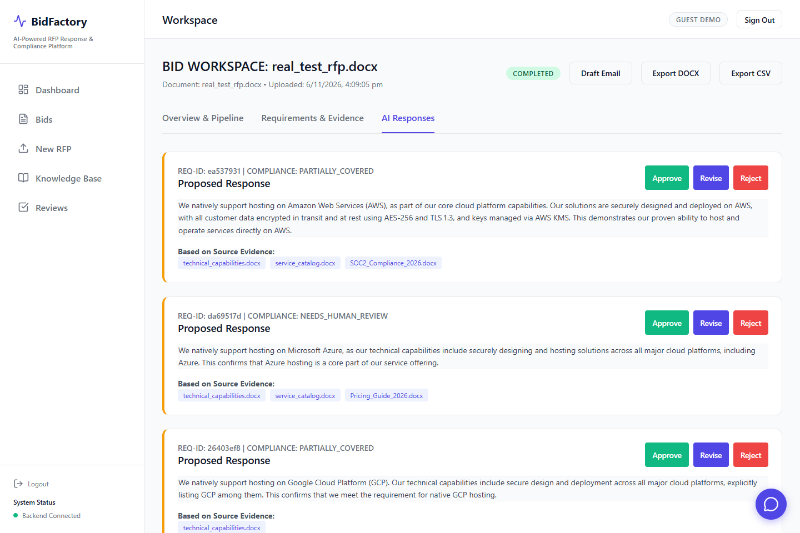
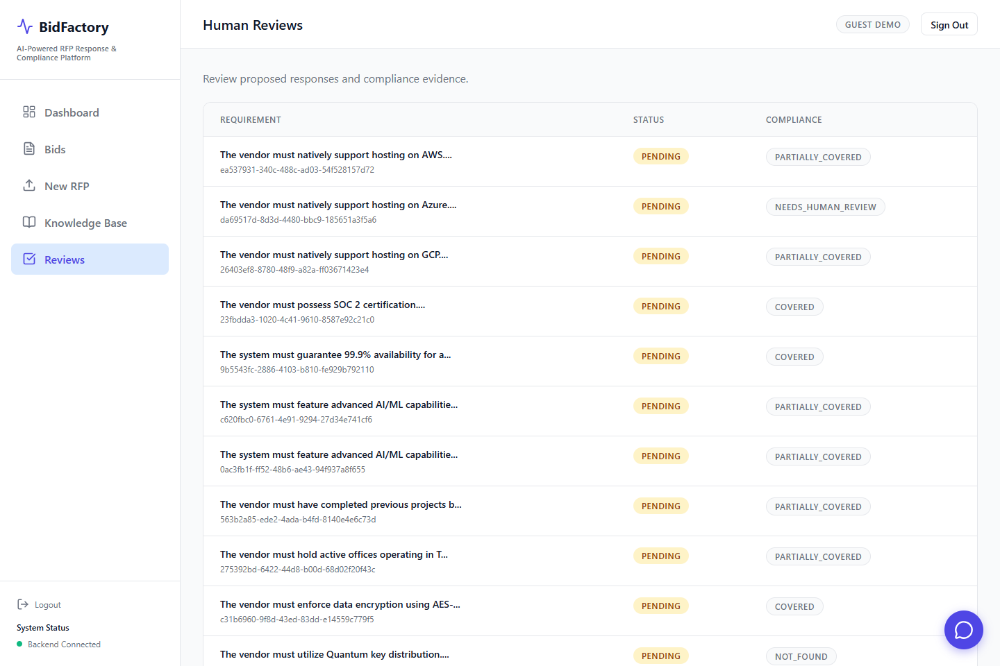
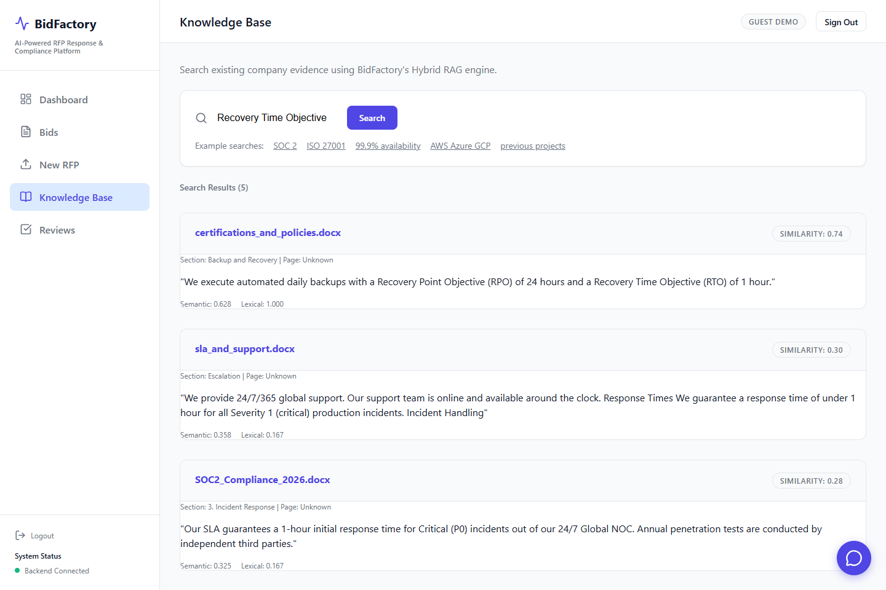

# BidFactory

**Answer RFPs from evidence you can prove. Anything you can't prove goes to a person.**

[](https://github.com/daanialmirza5/bid-factory-app/actions/workflows/ci.yml)


**[Open the live demo](https://bid-factory.onrender.com)**: choose **Continue to Enterprise Login**, then **Continue as guest**, and upload [this sample RFP](real_test_rfp.docx). It runs on Render's free tier, so the first request can take about a minute.

1st Prize at the RocketRide Buildathon, Mumbai (team entry).



## Results at a glance

Measured on 50 labelled requirements against the company knowledge base. The held-out column is the half that played no part in tuning. [Full results](eval/results/latest.md).

| What we measure | Why it matters | All 50 | Held out (25) |
| --- | --- | --- | --- |
| **Unsupported requirements wrongly marked Covered** | The costliest bid mistake is claiming what you can't prove | **0 of 20** | **0 of 10** |
| **Covered labels that were correct** | A reviewer can trust a Covered label | **25 of 25** | **12 of 12** |
| **Supported requirements marked Covered** | The tool has to save work, not send everything to review | **25 of 30** (83.3%) | **12 of 15** (80%) |
| **Correct source document ranked first** | Evidence has to come from the right place | **30 of 30** | **15 of 15** |

These numbers come from 12 synthetic company documents and small labelled sets. They describe this configuration and do not predict accuracy on real tenders.

## The problem

Responding to an RFP means reading a long document, pulling out every requirement, checking each one against what the company can prove, and drafting answers. It is slow, and a confident answer that the company can't back up can cost the contract.

BidFactory automates the reading and drafting but leaves the decisions to people. Every answer points to its evidence, and anything without evidence is flagged.

## How it works



1. **Extract.** The LLM returns requirements as JSON, and each one is validated against a schema. It is told to keep the RFP's wording and never invent requirements.
2. **Retrieve.** Documents are split into section-sized chunks and embedded with `all-MiniLM-L6-v2` on ONNX Runtime. Results are ranked by 70% semantic similarity and 30% keyword overlap.
3. **Check support.** A requirement is `COVERED` only if its match score is at least 0.45 and at least half its terms appear in the closest passage. If the requirement states a figure that passage doesn't contain, it goes to human review, because "15 minutes" is not supported by evidence saying "1 hour".
4. **Draft.** The model sees the requirement and the evidence, and nothing else. A draft containing a figure found in neither is rejected, and the answer falls back to quoting the evidence.
5. **Review.** Every answer lands in a queue where a person approves, revises or rejects it. Nothing is sent automatically.

## Screens

| Requirements and their evidence | Draft answers |
| --- | --- |
|  |  |

| Human review queue | Knowledge base search |
| --- | --- |
|  |  |

## How we measure whether the output is correct

The labelled data is in [`eval/gold`](eval/gold). The expected answers were written before the first evaluation run, and anyone can check them against the [knowledge base](data/knowledge_base).

| Stage | Labelled data | Metric | Result |
| --- | --- | --- | --- |
| Retrieval | 30 supported requirements with their source documents | Correct document ranked first | 100% (30/30) |
| Compliance | 30 supported and 20 unsupported requirements | Unsupported marked Covered | 0% (0/20) |
| Compliance | Same | Covered labels that were correct | 100% (25/25) |
| Compliance | Same | Supported marked Covered | 83.3% (25/30) |
| Compliance | Same | Unsupported marked Partial, which always goes to a reviewer | 5% (1/20) |
| Extraction (LLM) | 25 requirements in 4 RFPs, 3 runs each | Requirements found (recall) | 84% to 94.7% across two evaluation runs |
| Extraction (LLM) | Same | Output grounded in the source document | 94.5% (69/73) in the latest run |
| Extraction (LLM) | Same | Runs returning schema-valid JSON | 11 of 12 in the latest run |
| Extraction (rules) | Same | Requirements found (recall) | 92% (23/25) |
| Drafting | 45 LLM drafts | Rejected for an unsupported figure | 2.2% (1/45) |
| Drafting | Same | Final answers with every figure supported | 100% (45/45) |
| Drafting | 5 requirements with no evidence | Refused rather than claimed | 100% (5/5) |

Compliance checks take about 9 ms per requirement (p50). LLM extraction takes about 4.7 s per document (p50), and drafting about 1.9 s per answer (p50).

**How tuning stays honest.** Thresholds are chosen by [`eval/calibrate.py`](eval/calibrate.py) on the odd-numbered items only: no unsupported requirement may be marked Covered, then as many supported ones as possible. The even-numbered items are held out.

### What the first evaluation found

The first run looked safe but was close to useless, and the existing unit tests had not caught it.

| Metric (all 50 items) | [First run](eval/results/baseline-before-chunking-fix.md) | Now |
| --- | --- | --- |
| Supported requirements marked Covered or Partial | 0 of 30 | 30 of 30 |
| Supported requirements marked Covered | 0 of 30 | 25 of 30 |
| Correct source document ranked first | 28 of 30 | 30 of 30 |
| Unsupported requirements wrongly marked Covered | 0 of 20 | 0 of 20 |

- **Root cause.** Each document was stored as one chunk, so a one-sentence requirement was compared with a whole document. Scores stayed between 0.33 and 0.55 and never reached the original hand-set thresholds of 0.60 and 0.70.
- **Fix.** Section-sized chunks, thresholds calibrated on labelled data, and a check that required figures appear in the evidence.
- **Other bugs the evaluation exposed.** Direct extraction rewrote "supplier" as "vendor" and skipped schema validation. Draft prompts never included the requirement. One draft stated figures of 5,000 and 10,000 that appear nowhere in the evidence, which is why the figure check exists.

### Reproduce it

```bash
python scripts/ingest_kb.py
python -m eval.calibrate                                  # tune on the development half
python -m eval.run_eval                                   # retrieval, compliance, rule-based extraction
ROCKETRIDE_GROQ_KEY=... python -m eval.run_eval --llm     # adds LLM extraction and drafting
```

## Tests

72 pytest tests run in [GitHub Actions](https://github.com/daanialmirza5/bid-factory-app/actions) on every push, alongside the frontend lint and production build. They use stubs, so they check behaviour without calling an LLM. The evaluation above is what measures accuracy.

| Test file | Tests | What it proves |
| --- | --- | --- |
| [`test_orchestration.py`](tests/test_orchestration.py) | 17 | The pipeline runs in order and reports failures |
| [`test_compliance_analysis.py`](tests/test_compliance_analysis.py) | 10 | Status rules, the figure check, and that unrelated evidence is never Covered |
| [`test_response_generation.py`](tests/test_response_generation.py) | 9 | Drafts use only evidence, and unsupported figures are rejected |
| [`test_rocketride_service.py`](tests/test_rocketride_service.py) | 9 | Pipeline calls, the direct fallback, and safe error messages |
| [`test_review_workflow.py`](tests/test_review_workflow.py) | 8 | Approve, reject and revise transitions |
| [`test_requirement_extraction.py`](tests/test_requirement_extraction.py) | 6 | Schema validation and rule-based extraction |
| [`test_conflict_detection.py`](tests/test_conflict_detection.py) | 5 | Contradictions in evidence are flagged |
| [`test_rag.py`](tests/test_rag.py) | 5 | Ingestion, chunking, retrieval and duplicate handling |
| [`test_rate_limit.py`](tests/test_rate_limit.py) | 3 | The public demo's limit on LLM calls |

```bash
python -m pytest
cd frontend && npm run lint && npm run build
```

## Architecture

| Part | Technology | Where it runs |
| --- | --- | --- |
| Web app | React 18, TypeScript, Vite, Firebase sign-in or guest access | Served by the API |
| API | FastAPI, Python 3.12 | Render, from the [`Dockerfile`](Dockerfile) |
| Extraction | Groq (`openai/gpt-oss-20b`), with an optional [RocketRide pipeline](bid_factory.pipe) | Groq |
| Knowledge base | 12 documents, fastembed (ONNX), SQLite vector store | Built into the image |
| Drafting | Groq, with a figure check | API |

**The live demo calls Groq directly.** The RocketRide pipeline used at the buildathon is still in the repository and runs when `ROCKETRIDE_URI` and `ROCKETRIDE_APIKEY` are set. The figures above measure the direct route.

## Run locally

```bash
pip install -r requirements.txt
python scripts/ingest_kb.py
python -m uvicorn backend.main:app --reload --port 8000

cd frontend && npm install && npm run dev    # http://localhost:3000
```

Copy `.env.example` to `.env`. `ROCKETRIDE_GROQ_KEY` enables the LLM, and `AI_FALLBACK_DIRECT_GROQ=true` calls Groq directly when RocketRide isn't configured. Secrets are read only from the environment.

## Known limitations

- The knowledge base is synthetic, and the labelled sets are small. A real tender set is the next step.
- `Pricing_Guide_2026.docx` has lost its currency amounts (it reads ",000 annually"), so pricing questions can't be answered properly.
- Extraction varies between runs, and it doesn't yet retry after invalid JSON.
- Bids and reviews live in memory and reset when the server restarts.
- Image uploads need Tesseract, which the Docker image doesn't include, so the demo accepts PDF and DOCX.

## License

[MIT](LICENSE)
